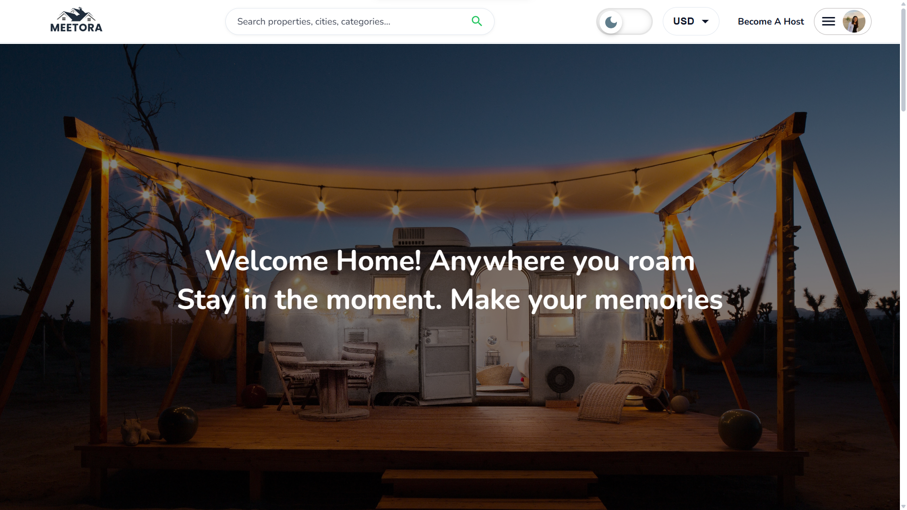
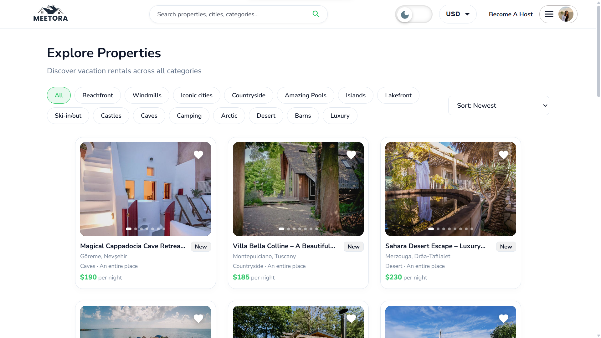
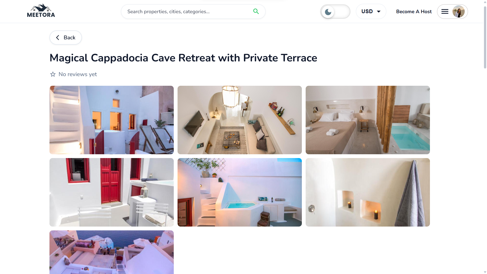
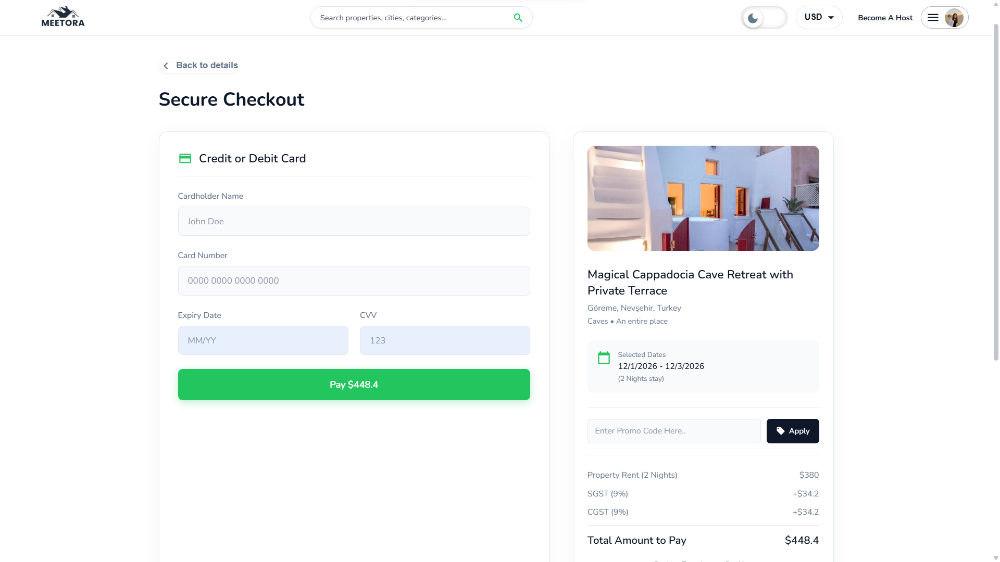

# 🏡 Meetora – Property Booking & Hosting Platform

## 1. Project Overview

Meetora is a web-based property booking and hosting platform where users can explore properties, view property details, and manage their bookings.

The platform aims to make the property discovery and booking process simple and convenient. It also allows hosts to manage their property listings.

I developed Meetora as a full-stack web development project to gain practical experience in building real-world applications. Through this project, I worked with frontend development, backend APIs, database management, and user authentication.

## 2. Live Demo

🌐 **Live Website:** https://meetora-frontend-6hmk.onrender.com/

💻 **GitHub Repository:** https://github.com/Meet-Savani/MEETORA

## 3. Screenshots

Here are some screenshots of the application.

### Homepage


### Property Listing


### Property Details


### Booking Page


## 4. Features

- Explore and discover available properties.
- View detailed information about properties.
- User registration and login.
- Manage property listings as a host.
- Manage property booking information.
- Responsive user interface.
- Cloud-based property image management.

## 5. Admin Panel

- Manage users
- Manage property listings
- Monitor bookings
- View and manage platform data

## 6. Tech Stack

**Frontend**
- React.js
- Vite
- JavaScript
- Material UI (MUI)
- SCSS
- React Router DOM
- Redux Toolkit
- Axios

**Backend**
- Node.js
- Express.js
- MongoDB
- Mongoose
- JSON Web Token (JWT)
- bcryptjs

**Tools & Services**
- Cloudinary
- PDFKit
- Git & GitHub
- Render

## 7. Project Structure

```text
MEETORA/
├── frontend/
│   ├── public/
│   ├── src/
│   │   ├── assets/
│   │   ├── components/
│   │   ├── config/
│   │   ├── hooks/
│   │   ├── layouts/
│   │   ├── pages/
│   │   ├── redux/
│   │   ├── styles/
│   │   ├── utils/
│   │   ├── App.jsx
│   │   └── main.jsx
│   └── package.json
│
├── backend/
│   ├── middleware/
│   ├── models/
│   ├── routes/
│   ├── utils/
│   ├── index.js
│   └── package.json
│
└── README.md
```

## 8. Installation & Setup

**Step 1: Clone the repository**

```bash
git clone https://github.com/Meet-Savani/MEETORA.git
cd MEETORA
```

**Step 2: Install backend dependencies**

```bash
cd backend
npm install
```

**Step 3: Configure environment variables**

Create a `.env` file in the backend folder and add the required configuration.

**Step 4: Start the backend**

```bash
npm run dev
```

**Step 5: Install and start the frontend**

Open another terminal:

```bash
cd frontend
npm install
npm run dev
```

Open the local URL provided by Vite to use the application.

## 9. Environment Variables

Create a `.env` file inside the backend directory.

Example:

```env
PORT=your_port_number
MONGODB_URI=your_mongodb_connection_string
JWT_SECRET_KEY=your_jwt_secret
CLOUDINARY_CLOUD_NAME=your_cloudinary_name
CLOUDINARY_API_KEY=your_cloudinary_api_key
CLOUDINARY_API_SECRET=your_cloudinary_api_secret
```


## 10. API Documentation

Meetora uses a REST API built with Express.js to handle communication between the frontend and backend.

The API manages user authentication, property information, bookings, and other application operations.

Detailed endpoint documentation can be added here as the project develops.

## 11. Future Improvements

- Add an online payment gateway
- Improve the admin dashboard
- Add advanced property search and filters
- Improve website performance and security
- Add more features based on user feedback

## 12. Author

**Meet Savani**

B.Sc. Information Technology Graduate | Aspiring AI & Machine Learning Enthusiast

- GitHub: [Meet-Savani](https://github.com/Meet-Savani)
- Project Repository: [MEETORA](https://github.com/Meet-Savani/MEETORA)

## 13. License

This project is developed for learning and educational purposes.

No open-source license has currently been specified.